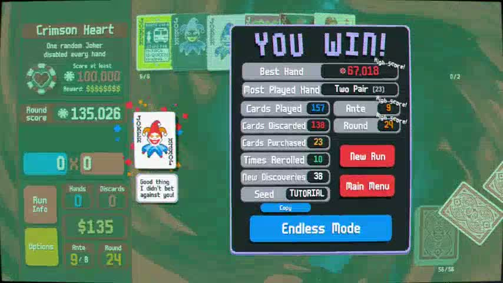

# Balatro through computer use

A recorded Balatro tutorial-seed win, played by an AI assistant using visible game screens and computer-use inputs on Windows.



## Watch or download

[**Download the recording from the release**](https://github.com/0mis/balatro-computer-use/releases/tag/recording-v1)

- **Phone copy:** one complete 854 x 480 MP4 at 15 fps, approximately 439 MiB.
- **Full-quality original:** 1280 x 720 MP4 at 30 fps, provided as two binary parts. Download both parts and run `scripts/Join-Recording.ps1` to restore the original file.
- Both copies contain the full **2:33:08** session, including setup, early slow play, and observation troubleshooting. Video playback has not been sped up.
- Capture uses the game image and game audio. Desktop audio and microphone capture were disabled.

The release includes SHA-256 checksums. Exact lengths, sizes, and hashes are in [the recording manifest](assets/recording-manifest.json).

## Result

| Field | Result |
| --- | --- |
| Seed | `TUTORIAL` |
| Deck | Red Deck |
| Outcome | Won after completing Ante 8 |
| Final boss | Crimson Heart |
| Final boss round score | 135,026 |
| Best single hand | 67,018 |
| Rounds completed | 24 |
| Most played hand | Two Pair, 23 times |

[Run statistics](results/run.json) are transcribed from the visible victory screen. The game displays Ante 9 after the Ante 8 win.

The assistant chose the Balatro plays from screenshots. The included scripts handle recording review, conversion, and file assembly. Gameplay requires an assistant with authorized computer-use access.

## How the session worked

1. OBS recorded one Balatro Game Capture source with application audio enabled.
2. The assistant read the game screen, chose cards and shop purchases, and sent clicks through the computer-use tools.
3. Later in the session, Balatro was changed from Borderless to Windowed mode. Direct native screenshots then updated correctly in this session.
4. Game animations were set to 4x during play. This changes the game's animation timing, not model inference speed.
5. Recording stopped after the victory screen. No second run was started.

See [the capture setup and observation notes](docs/setup.md) and [the reference capture settings](config/capture-settings.json).

## Media utilities

Requirements: Windows PowerShell 5.1 or newer, and FFmpeg/FFprobe on `PATH`. Game capture additionally requires Balatro, OBS, and authorized computer-use tools.

Restore the full-quality recording after downloading both release parts:

```powershell
.\scripts\Join-Recording.ps1 -PartsDirectory "$HOME\Downloads" -OutputPath "$HOME\Videos\Balatro-winning-run-720p.mp4"
```

Remux an OBS MKV to MP4 without re-encoding:

```powershell
.\scripts\Convert-Recording.ps1 -InputPath .\recording.mkv -OutputPath .\recording.mp4 -Mode Remux
```

Create a smaller full-length copy using the software-encoding settings used for this release:

```powershell
.\scripts\Convert-Recording.ps1 -InputPath .\recording.mp4 -OutputPath .\phone.mp4 -Mode Phone
```

Extract a recent frame from an active MKV as a fallback when direct game screenshots stop updating:

```powershell
.\scripts\Capture-CurrentFrame.ps1 -RecordingDirectory .\recordings -OutputPath .\current-game.png
```

The frame helper is adapted from the session's local fallback script. It reads an existing recording and does not send game input. Buffering makes it slower than a fresh direct screenshot; use it only when needed.

## Files

- `assets/win.jpg`: a frame extracted from the completed recording.
- `assets/recording-manifest.json`: recording metadata and checksums.
- `results/run.json`: the observed game result.
- `config/capture-settings.json`: portable reference values for the OBS setup.
- `docs/setup.md`: capture workflow and the limitations observed in this session.
- `scripts/`: media utilities.

The commercial game and the installed computer-use runtime are separate requirements.
